# Ledge-3.0 User Manual

Version 1.0.0 · October 2026

*Your application journey, transformed into tests.*

## 1. Introduction

Ledge-3.0 is a Google Chrome extension. You record a user journey in the browser, and Ledge-3.0 uses an AI model to turn it into structured manual test cases. As a separate step, you can convert the test cases you select into a Playwright or Selenium automation script that follows the format of a reference script from your own project.

Everything runs inside Chrome. There is no server to install: the extension calls the AI provider directly with the API key you enter in its Settings tab.

### 1.1 What you can do with Ledge-3.0

- Record clicks, text entry, selections, checkboxes, form submits and page navigation on any http or https page, including iframes and shadow DOM.
- Generate manual test cases with preconditions, test data, numbered steps, expected results, type and priority.
- Choose the AI provider: OpenAI, Anthropic, Google Gemini or Inception Labs.
- Control the output: language, number of test cases (1 to 40), coverage types and priorities.
- Review, search, filter by type and priority, select, and export all or selected cases to CSV, Markdown or JSON.
- Convert to automation with AI assistance or a grounded local template for the cases you tick.
- See token usage and cost for every run, with a comparison across all listed models.

### 1.2 How it works

| Part | What it does |
|---|---|
| Side panel | Where you record, configure, generate and review. It has five tabs: Record, Generate, Results, Automation and Settings. |
| Recorder | Runs inside the web page you are testing and reports each action to the extension. |
| Service worker | The extension's background process. It stores your recording and settings, builds the prompt, calls the AI provider you chose and saves the result. |

When you click Generate test cases, Ledge-3.0 sends the recorded actions and a snapshot of the page (title, headings, form fields, buttons and links) to the AI provider you selected, using your API key, and shows the test cases on the Results tab.

> **Note:** Your API key is stored in Chrome on this computer and is sent only to the provider it belongs to. Read section 10 before you add a key.

### 1.3 About the examples in this manual

The screenshots were taken in Chromium with Ledge-3.0 loaded as an unpacked extension, against a small two-page demo web shop (DemoShop: a sign-in page and a profile page) that ships in docs/demo-shop/. Screens that need a live AI response are shown as placeholders in this edition. AI output varies from run to run, so the test cases and scripts you generate will differ in wording.

## 2. System requirements

| Requirement | Minimum | How to check |
|---|---|---|
| Operating system | Windows 10/11, macOS or Linux | — |
| Google Chrome | 116 or later (needs the side panel API) | Open chrome://version |
| AI provider API key | At least one of OpenAI, Anthropic, Google Gemini or Inception Labs | See section 4.2 |
| Internet access | To reach the AI provider's API | — |

Node.js is not needed to use Ledge-3.0. It is used only by the project's developer tools (tests and screenshots).

## 3. Installation

Installation takes about 5 minutes.

### 3.1 Get the extension folder

Copy the Ledge-3.0 folder to your computer. The folder that contains manifest.json is the extension.

| Folder / file | Contents |
|---|---|
| manifest.json, background/, content/, sidepanel/, shared/, icons/ | The extension itself |
| docs/ | This manual (Markdown, Word and PDF), screenshots and the DemoShop pages |
| test-pages/, tests/, tools/, package.json | Developer tools; not used by the extension |
| README.md, INSTALLATION.md | Overview and installation guide |

### 3.2 Load the extension in Chrome

1. Open Chrome and go to chrome://extensions.
2. Turn on Developer mode (toggle in the top-right corner).
3. Click Load unpacked.
4. Select the Ledge-3.0 folder (the folder that contains manifest.json).
5. Ledge-3.0 appears in the list. Make sure its toggle is on.
6. Click the puzzle-piece icon in the Chrome toolbar and pin Ledge-3.0 so its icon is always visible.

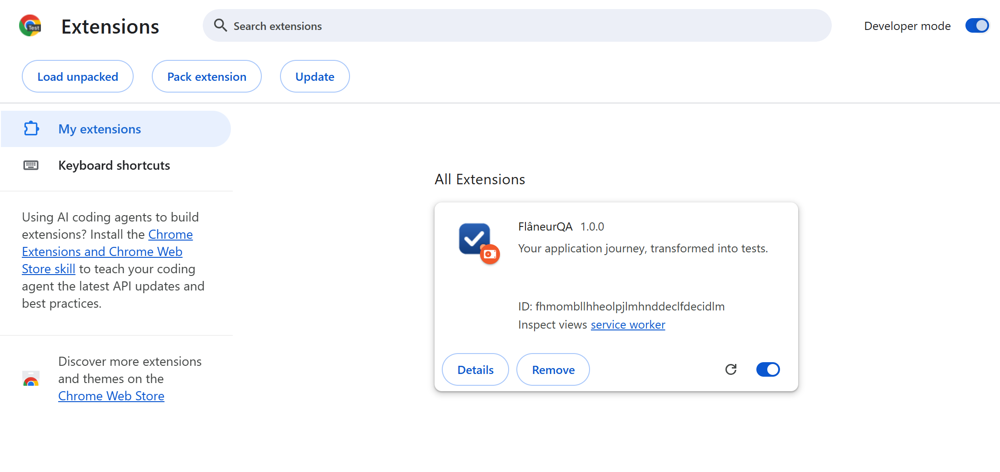

*Figure 1. chrome://extensions with Developer mode turned on and Ledge-3.0 loaded.*

### 3.3 Add an API key

1. Open any website, for example https://example.com.
2. Click the Ledge-3.0 icon in the toolbar. The side panel opens on the right of the window.
3. Open the Settings tab.
4. Paste the key for your provider into its field and click Save. The field is cleared, the chip next to the provider changes to Saved, and the header pill counts the key.

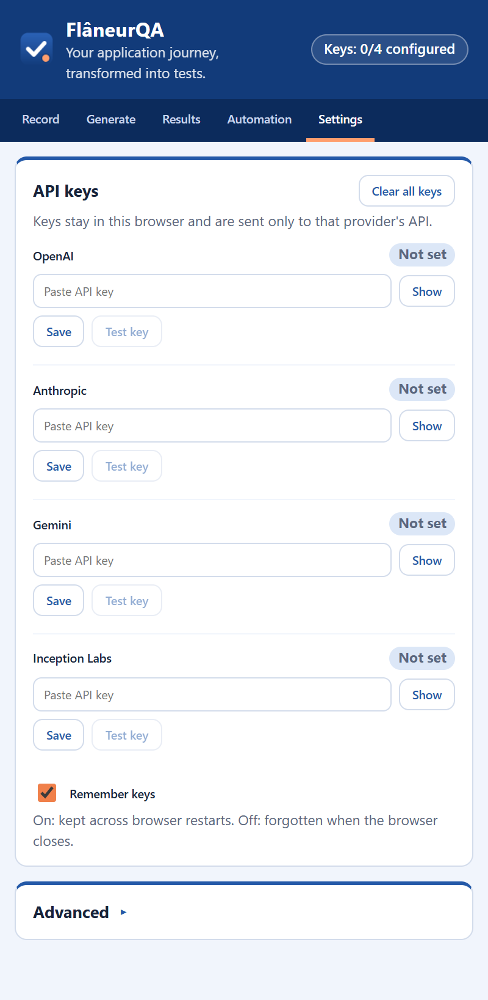

*Figure 2. The Settings tab before any key is saved.*

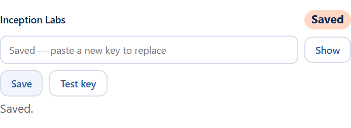

*Figure 3. A saved key. The key itself is never shown again; paste a new one to replace it.*

### 3.4 Verify the installation

1. On the Settings tab, click Test key next to the provider. Ledge-3.0 asks the provider for its model list.
2. The note under the key should read Key works (N models available). If it shows an error, see section 9.
3. If the page you want to test was already open before you installed the extension, reload it so recording can work there.

> **[PLACEHOLDER P1]** Screenshot: Settings tab after Test key succeeds, showing "Key works (N models available)" under the provider. Needs a live API key.

## 4. Configuration: the Settings tab

All configuration lives in the side panel. There is no configuration file.

### 4.1 API keys

Each provider has a row with a key field and four buttons:

| Control | Purpose |
|---|---|
| Show / Hide | Shows the text you are typing before you save it. |
| Save | Stores the key in Chrome, replacing any saved key for that provider. Press Enter in the field to do the same. |
| Test key | Calls the provider's model list with the saved key. Enabled once a key is saved. |
| Clear all keys | Removes every saved key after you confirm. |

The header pill, for example Keys: 1/4 configured, shows how many providers have a key. Click it to open the Settings tab.

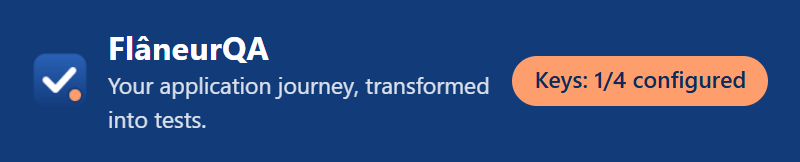

*Figure 4. The side panel header. The pill shows how many providers have a key.*

You only need a key for the providers you use. A provider without a key returns an error if you try to generate with it.

### 4.2 Getting an API key

| Provider | Where to create a key |
|---|---|
| OpenAI | https://platform.openai.com/api-keys |
| Anthropic | https://console.anthropic.com/settings/keys |
| Google Gemini | https://aistudio.google.com/apikey |
| Inception Labs | https://platform.inceptionlabs.ai |

> **Important:** Create a key just for Ledge-3.0. Where the provider allows it, restrict the key (for example to model access only) and set a low spending limit. See section 10.

### 4.3 Remember keys

| Setting | Behaviour |
|---|---|
| Remember keys on (default) | Keys are kept in Chrome's extension storage on this computer and survive browser restarts. |
| Remember keys off | Keys are kept in session storage and are forgotten when Chrome closes. |

Switching the setting moves the saved keys to the new location.

### 4.4 Advanced

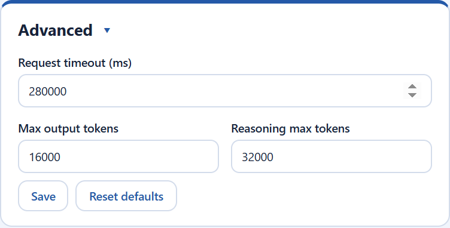

*Figure 5. Advanced settings with their defaults.*

| Setting | Default | Purpose |
|---|---|---|
| Request timeout (ms) | 280000 | How long to wait for the AI provider on each request (280000 = 4 min 40 s). Range 10000 to 280000. |
| Max output tokens | 16000 | Maximum output tokens per request for standard models. Thinking tokens count against this limit. |
| Reasoning max tokens | 32000 | Maximum output tokens for OpenAI reasoning models (names starting with o1, o3, gpt-5 or gpt-6). |

Click Save to apply your values (out-of-range values are clamped) or Reset defaults to restore them.

### 4.5 Model availability

The model list on the Generate tab starts from a built-in list of current models. Providers add and retire models over time, so:

- Click ↻ next to the model list to load the models your key can actually use, straight from the provider. The hint under the list then says live list instead of default list.
- Models get retired. If a model disappears from the provider or returns model not found, click ↻ and pick another one.
- OpenAI models that work only with OpenAI's Responses API are hidden. Ledge-3.0 uses Chat Completions; when a model refuses it, the model is marked and no longer listed.
- Older OpenAI models that are being shut down (such as gpt-4 models, o4-mini and the plain gpt-5, gpt-5-mini and gpt-5-nano) are not listed.
- Inception Labs always uses mercury-2, so ↻ is disabled for it.
- Prices are list prices per million input and output tokens. A price marked check pricing has not been confirmed on the provider's pricing page.

> **[PLACEHOLDER P2]** Screenshot: the Model card after clicking ↻, with the hint reading "live list". Needs a live API key.

### 4.6 Other saved settings

Provider, model, temperature, reasoning effort, language, number of cases, coverage, priorities, prompt, automation framework, language and reference scripts are saved automatically and are still there the next time you open the panel. The last results and the last automation script are also kept.

## 5. The Ledge-3.0 side panel

Click the Ledge-3.0 icon in the Chrome toolbar to open the side panel. It has a header with the keys pill and five tabs:

| Tab | Use it to |
|---|---|
| Record | Start and stop recording, mask typed values, and review the captured actions. |
| Generate | Choose the AI provider and model, set output options and the prompt, and generate manual test cases. |
| Results | Review, search, filter, export and select test cases. |
| Automation | Convert the selected test cases into a Playwright or Selenium script. |
| Settings | Manage API keys, Remember keys and Advanced limits. |

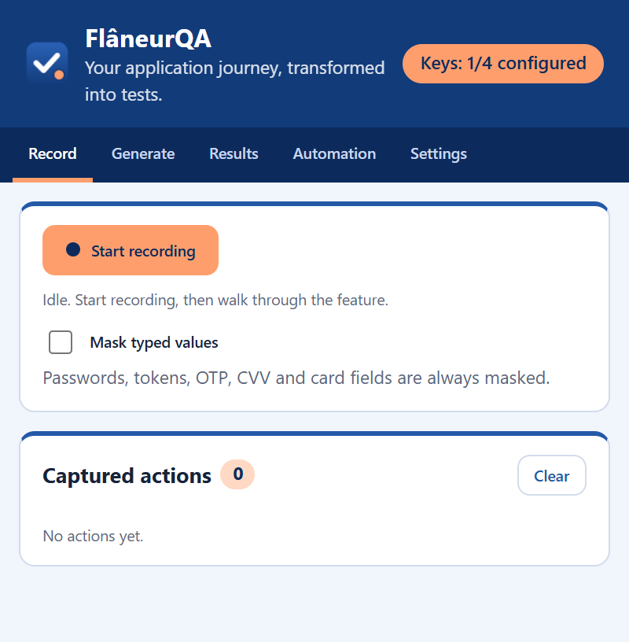

*Figure 6. The side panel, Record tab, before recording.*

## 6. Generating manual test cases

This chapter walks through a complete example: recording a sign-in and a profile update on DemoShop, then generating manual test cases from it.

### Step 1: Open the page you want to test

In Chrome, open the first page of the feature you want to test. Recording works on any http or https page. It does not work on chrome:// pages, the Chrome Web Store or local file:// pages; the Record tab shows a message and disables Start recording there.

> **Tip:** To try the DemoShop pages yourself, serve the docs/demo-shop folder over http, for example with npx serve docs/demo-shop, and open the address it prints.

### Step 2: Record the user journey

1. Make sure the page you want to test is the active tab.
2. On the Record tab, click Start recording. The recorder card turns peach, a timer starts, and the page shows a Ledge-3.0 recording badge in the bottom-right corner.
3. Walk through the feature as a tester would: fill in forms, tick checkboxes, choose options, click buttons and move between pages. Navigation in the same tab, including single-page-app route changes, is recorded continuously, so one recording can cover several pages.

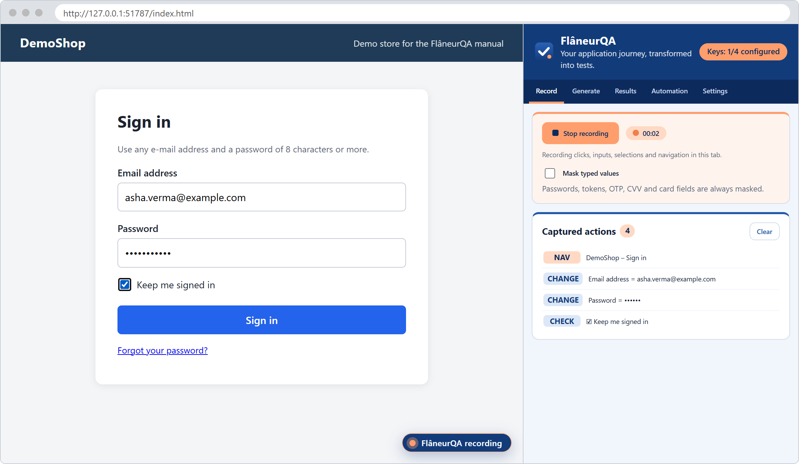

*Figure 7. Recording on the DemoShop sign-in page. Note the Ledge-3.0 recording badge on the page and the timer in the panel.*

Each action appears under Captured actions as you work:

| Action | Recorded when you… |
|---|---|
| NAV | Open or move to a page (including the page that was open when recording started). |
| CHANGE | Type into a text field (repeated edits of the same field are merged into the final value). |
| SELECT | Choose an option in a drop-down list. |
| CHECK | Tick or untick a checkbox or radio button. |
| CLICK | Click a button, link or other control. |
| SUBMIT | Submit a form. |
| KEYDOWN | Press Enter or Escape in a field. |

Actions inside an iframe or a shadow root are tagged iframe or shadow. Up to 1,000 actions and approximately 1 MB of event data are kept.

Password, verification-code, token, API-key, card, bank-account and other recognised sensitive values are masked before the journey is stored or sent to an AI provider. URL credentials and sensitive query/fragment values are redacted. Turn on Mask typed values to replace every typed value with ••••••.

> **Tip:** Use realistic test data while recording. The values you type become the test data in the generated cases and in automation scripts. Never use real customer data, because the recording is sent to the AI provider.

### Step 3: Stop recording

Click Stop recording. The card returns to idle and keeps the captured actions. Click Clear to discard them. Starting a new recording also replaces the previous one.

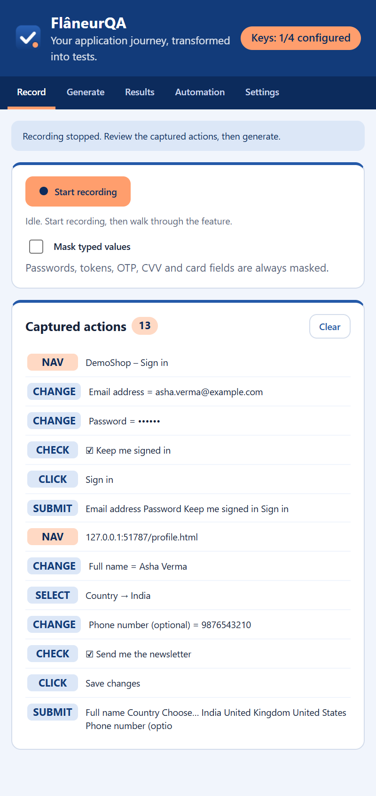

*Figure 8. Recording stopped with 13 actions captured across the sign-in and profile pages. The password is shown as ••••••.*

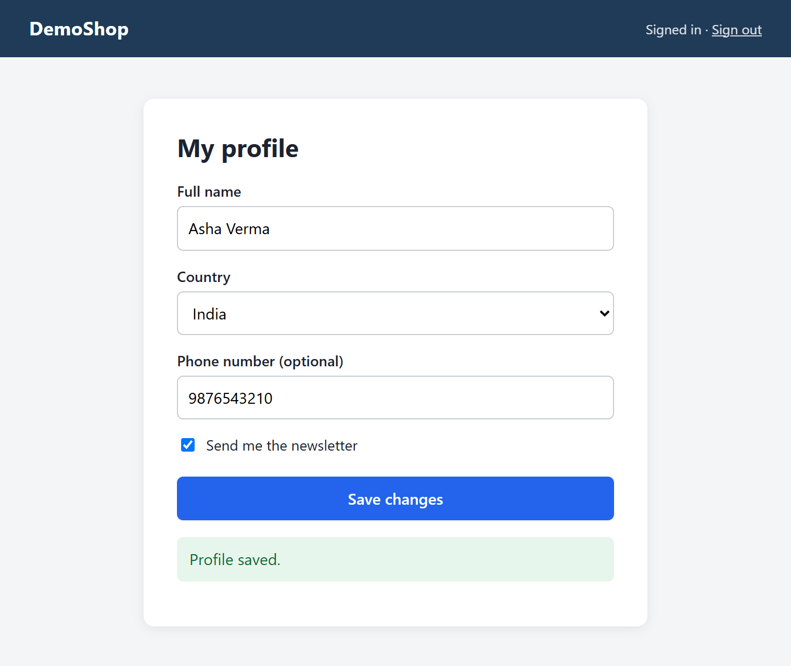

*Figure 9. The second DemoShop page at the end of the journey.*

### Step 4: Choose the AI provider and model

On the Generate tab, in the Model card:

1. Select a Provider: OpenAI, Anthropic, Gemini or Inception Labs. Use one that has a key.
2. Select a Model. The hint under the list shows its price per million input and output tokens. Click ↻ to load the models your key can use (section 4.5).
3. Set the Temperature (0 to 2, default 0.3). Lower values give more consistent, focused test cases. Current Claude models ignore it.
4. For OpenAI reasoning models (names starting with o1, o3, gpt-5 or gpt-6) a Reasoning effort list (Low, Medium, High) replaces the temperature.

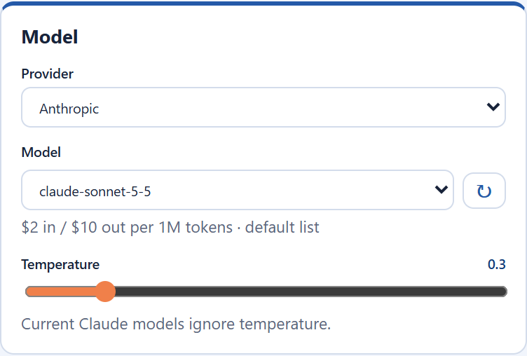

*Figure 10. Model card with Anthropic and claude-sonnet-5-5 (temperature slider).*

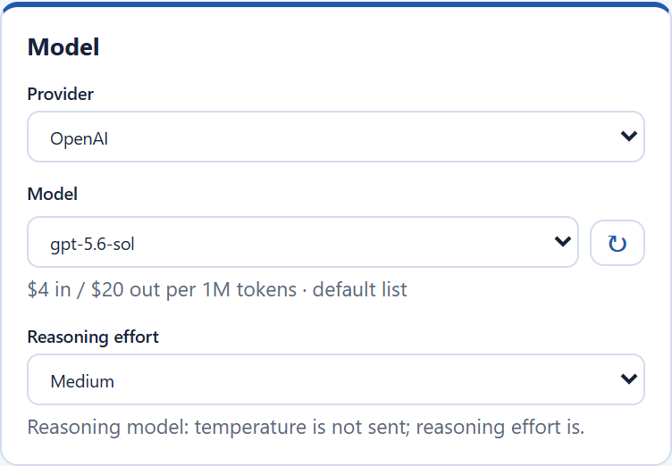

*Figure 11. Model card with OpenAI and gpt-5.6-sol (reasoning effort instead of temperature).*

### Step 5: Set the output options

| Option | Description |
|---|---|
| Language | Language the test cases are written in: US English, UK English, Spanish, French, German, Portuguese (Brazil), Hindi or Japanese. |
| Max test cases | Upper limit on the number of test cases, from 1 to 40 (default 15). |
| Coverage | Test types to include. Click a chip to turn it on or off. Functional, Negative and Boundary are on by default. |
| Priority | Generate only Critical, High, Medium and/or Low priority cases. At least one must stay selected. |

When a journey has been recorded, its ordered actions are added as the first case, titled **User Input**. The requested count includes this case. If the count is 1, Testleaf builds that case locally without calling the AI provider.

| Coverage type | What the AI looks for |
|---|---|
| Functional | The main flows work as intended. |
| Negative | Invalid input, missing required fields and error messages. |
| Boundary | Minimum and maximum lengths and values, limits of ranges. |
| Validation | Required, format and field-level validation rules. |
| Edge Case | Unusual but valid situations, such as double submission or empty optional fields. |
| UI | Layout, labels, visibility and state of controls. |
| Accessibility | Keyboard use, labels, focus order and screen reader support. |
| Security | Injection, masking of sensitive data, session and authorisation checks. |
| Compatibility | Browser and platform-specific behavior supported by the captured page. |
| Exploratory | Conservative, page-grounded scenarios outside the primary flow. |
| Usability | Clarity of messages and ease of completing the task. |

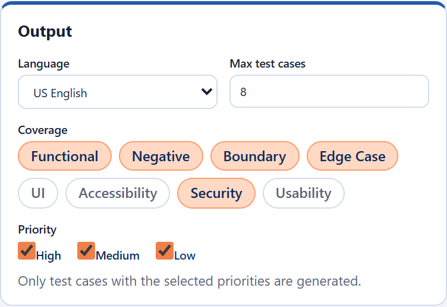

*Figure 12. Output options: 8 test cases with Functional, Negative, Boundary, Edge Case and Security coverage, all priorities.*

### Step 6: Choose the prompt (optional)

Under Prompt, Default prompt uses Ledge-3.0's built-in QA instructions, which work well for most applications. Expand Built-in instructions to read them. Choose Custom prompt to add your own instructions (up to 6,000 characters), for example your domain, the standards to follow, or areas to emphasise.

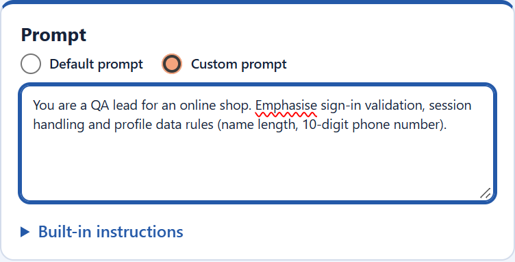

*Figure 13. A custom prompt with domain-specific guidance.*

### Step 7: Generate the test cases

Click Generate test cases at the bottom of the Generate tab. A status line shows Waiting for the model… and then Reading the response…; this usually takes a few seconds to a minute, depending on the model and the number of cases.

The request runs in the extension's background process, so you can close the side panel while it works; the result is saved and shown when you reopen it. If Chrome stops the background process in the middle, the panel shows Generation interrupted, try again.

> **[PLACEHOLDER P3]** Screenshot: Generate tab while a generation is running ("Waiting for the model…"). Needs a live API key.

When generation finishes, the panel switches to the Results tab.

### Step 8: Review the results

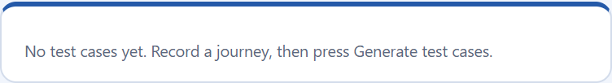

*Figure 14. The Results tab before the first generation.*

After a generation, the Results tab shows:

- The number of test cases, with the model, priorities, number of recorded actions, duration and time of generation.
- A usage card with input tokens, output tokens and the cost of the run. Expand Cost of this run on every model to compare what the same run would cost on each listed model.
- A short summary of the feature the AI identified.
- A search box and type and priority filters to narrow the list.
- Select all currently visible cases and choose whether exports include all cases or only selected cases.
- One card per test case with its ID, title, type, module and priority. Click a card to expand it and see preconditions, test data, numbered steps with expected results, and the overall expected result.

> **[PLACEHOLDER P4]** Screenshot: Results tab with the generated DemoShop test cases (header line, export buttons, summary, case list). Needs a live API key.

> **[PLACEHOLDER P5]** Screenshot: usage card with input tokens, output tokens and cost, with "Cost of this run on every model" expanded. Needs a live API key.

> **[PLACEHOLDER P6]** Screenshot: one expanded test case showing preconditions, test data, steps and expected results. Needs a live API key.

> **Note:** If the AI returns fewer cases than requested, or its response hit the output limit, a warning appears above the list.

### Step 9: Export the test cases

Use the buttons at the top of the Results tab:

| Button | Result |
|---|---|
| CSV | Downloads ledge-3.0-testcases-<date>.csv with one row per case (ID, Title, Module, Type, Priority, Preconditions, Test Data, Steps, Step Expected Results, Expected Result). Opens in Excel and imports into most test management tools. |
| Markdown | Downloads a .md document with a table of steps per case, plus the latest automation script if one was generated. |
| JSON | Downloads the full result, including usage and metadata, for use in other tools. |
| Copy | Copies the Markdown version to the clipboard. |

The last result is saved, so it is still there after you close and reopen the side panel.

## 7. Generating automation scripts

After you have manual test cases, Ledge-3.0 can convert the ones you select into a single Playwright or Selenium test file. Choose AI-assisted generation or a grounded local template that does not make a provider request.

### 7.1 How conversion works

- Your reference script is a strict template. The generated script copies its imports, structure, class and method naming, locator style, waits and assertions.
- Locators come only from the recording and the page snapshot (IDs, labels, roles and text that were actually captured). Ledge-3.0 does not invent selectors.
- Test data comes only from what you typed while recording, or from field labels.
- Anything that was not captured is marked TODO in the code and listed under Gaps to complete by hand, instead of being guessed.
- Iframes and shadow DOM are handled with frame and shadow-root locators based on what was recorded.

| Framework | Languages |
|---|---|
| Playwright | TypeScript, JavaScript, Python, Java, C#, Robot Framework (Browser library) |
| Selenium | Java, Python, JavaScript, C#, Robot Framework (SeleniumLibrary) |

### Step 1: Select the test cases to automate

On the Results tab, tick the checkbox on each test case you want to automate. Select all shown ticks every case currently visible (combine it with the search box or priority filter to select a group). The counter shows how many cases are selected. A new generation clears the selection.

> **[PLACEHOLDER P7]** Screenshot: Results tab with two test cases ticked and "2 selected for automation". Needs a live API key (cases must be generated first).

> **Tip:** Automate a few related cases at a time (for example 2 to 5). Smaller batches give more complete scripts and stay within the model's output limit.

### Step 2: Choose the framework and language

Open the Automation tab and click Playwright or Selenium. Choose a Generation method and Language. Both AI-assisted and local-template generation support the listed language combinations. The local template uses only captured URLs, selectors and values. Missing data, masked values, and unsupported frame traversal are reported as TODO gaps; it does not invent a locator or type a masked value. A reference script is used only in AI-assisted mode.

### Step 3: Add a reference script (AI-assisted mode only)

Paste a working test from your own project into the reference box or select a file up to 250 KB. It should use the framework you selected and ideally cover a similar page or flow. Ledge-3.0 remembers the last reference script for each framework. For example, a Playwright reference:

```
import { test, expect } from '@playwright/test';

test.describe('Sign in', () => {
  test('TC-000 sign in with valid credentials', async ({ page }) => {
    await page.goto('http://localhost:8810/index.html');
    await page.getByLabel('Email address').fill('user@example.com');
    await page.getByLabel('Password').fill(process.env.SHOP_PASSWORD ?? '');
    await page.getByRole('button', { name: 'Sign in' }).click();
    await expect(page).toHaveURL(/profile/);
  });
});
```

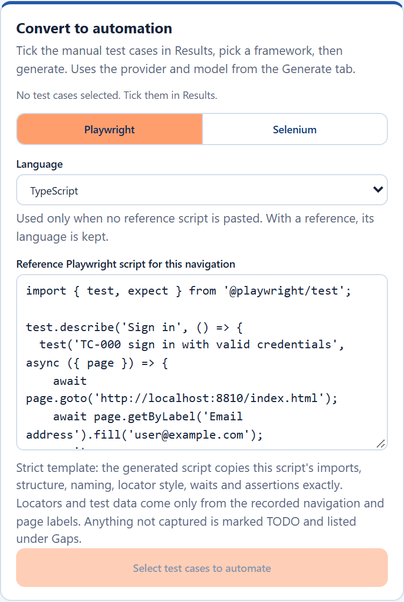

*Figure 15. Automation tab with Playwright selected and a reference script pasted. The button stays disabled until test cases are selected on the Results tab.*

Once cases are selected, the button shows how many will be converted, for example Generate Playwright script for 2 test cases.

> **Note:** You can leave the reference empty. Ledge-3.0 then writes a script in the selected language using the framework's common conventions.

### Step 4: Generate the script

Click Generate Playwright script for N test cases (or Selenium). AI-assisted mode uses your configured provider; local-template mode works offline. A status line shows progress and then how long the conversion took. The script appears below with:

- A header with the framework and language, the test case IDs, whether it follows your reference, the model, and token usage and cost.
- Gaps to complete by hand: things the recording did not capture, such as a locator for a success message that was never clicked.
- The generated code.

> **[PLACEHOLDER P8]** Screenshot: generated Playwright script for two DemoShop test cases, with the Gaps list. Needs a live API key.

> **[PLACEHOLDER P9]** Example output: the complete Playwright script from the same run, as a code listing. Needs a live API key.

### Step 5: Complete the gaps and save the script

1. Read each item under Gaps to complete by hand and search the code for TODO comments.
2. Click Copy to copy the code, or Download to save it with a file name the test runner recognises (see the table below).
3. Add the file to your test project, fill in the TODOs (for example add a missing assertion locator, or set a password environment variable), and run it.

| Language | Downloaded file name |
|---|---|
| TypeScript | ledge.spec.ts |
| JavaScript | ledge.spec.js (Playwright) or ledge.test.js (Selenium) |
| Python | test_ledge.py |
| Java | <ClassName>.java, using the class name in the code (LedgeTest if none is found) |
| C# | <ClassName>.cs, using the class name in the code (LedgeTests if none is found) |
| Robot Framework | ledge.robot |

> **Important:** Passwords and other sensitive values are masked during recording, so they never appear in generated scripts. Supply them from environment variables or your test configuration.

### 7.2 Example: Selenium with Java

To generate a Selenium script for the same cases, click Selenium, choose Java, and paste a Selenium reference test:

```
public class SignInTest extends BaseTest {
  @Test
  public void tc000_signInWithValidCredentials() {
    driver.get("http://localhost:8810/index.html");
    driver.findElement(By.id("email")).sendKeys("user@example.com");
    driver.findElement(By.id("password")).sendKeys(System.getenv("SHOP_PASSWORD"));
    driver.findElement(By.id("signin")).click();
    wait.until(ExpectedConditions.urlContains("profile"));
  }
}
```

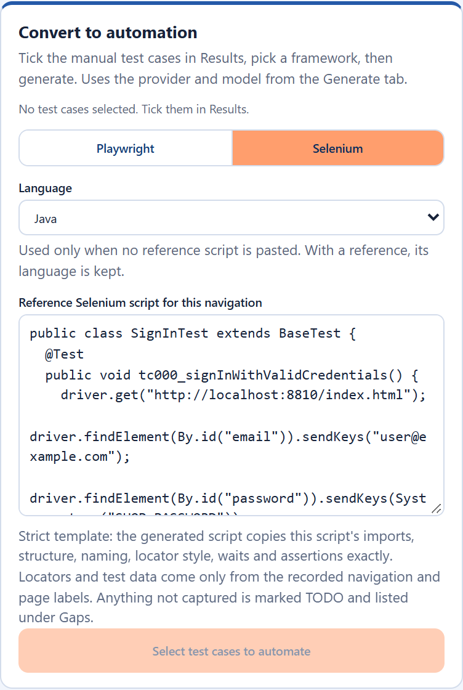

*Figure 16. Selenium options with a Java reference script.*

> **[PLACEHOLDER P10]** Screenshot: generated Selenium Java script following the BaseTest reference. Needs a live API key.

Only the most recent automation script is kept with the results. Copy or download a script before generating another one.

### 7.3 Tips for better automation scripts

- Record the exact flow you want to automate, including the final check (for example click the success message) so its locator is captured.
- Use a reference script that represents your current project conventions: base classes, page objects, wait helpers and assertion library.
- Generate manual cases first with the coverage you need, then automate a small group of related cases.
- If the script is cut off, select fewer cases or raise Max output tokens in Settings → Advanced.

## 8. Updating and uninstalling

### 8.1 Updating

1. Replace the files in the Ledge-3.0 folder with the new version (same folder path).
2. In chrome://extensions, click the reload icon (↻) on the Ledge-3.0 card.
3. Reload the web pages you want to record, then reopen the side panel.

Your keys, panel settings and last results are kept across updates.

### 8.2 Uninstalling

1. In chrome://extensions, click Remove on the Ledge-3.0 card. This deletes the recordings, settings, results and API keys stored by the extension.
2. Delete the Ledge-3.0 folder.
3. If you no longer need the API keys, revoke them in each provider's console.

## 9. Troubleshooting

| Problem | Cause and fix |
|---|---|
| “Manifest file is missing or unreadable” | The wrong folder was selected in Load unpacked. Select the folder that contains manifest.json. |
| Record tab says the page can't be recorded | Recording works only on http/https pages, not on chrome:// pages, the Web Store or local files. Serve local pages over http. |
| No actions are captured | The page was open before the extension was installed or reloaded. Reload the page and start recording again. |
| “… the API key was rejected. Check it in Settings.” (401) | The key is wrong, revoked or for another provider. Paste it again and click Test key. |
| “… model not found. Click ↻ to refresh the model list.” (404) | The model was retired or your key cannot use it. Click ↻ and pick another model (section 4.5). |
| “… rate limit or quota reached” (429) | Wait a moment, or check your plan and billing with the provider. |
| “… request timed out after N s” | Try a faster model, lower Max test cases, or raise Request timeout in Settings → Advanced. |
| Warning: the model hit its output limit | Lower Max test cases, automate fewer cases, or raise Max output tokens (or Reasoning max tokens) in Settings → Advanced. |
| “… returned a response that is not valid JSON” or no test cases | Try again or pick a different model. Smaller models sometimes add text around the JSON. |
| “Generation interrupted, try again.” | Chrome stopped the extension's background process during the run. Generate again. |
| A model is missing from the list | It may be retired, excluded, or Responses-only (section 4.5). Click ↻ to load your key's live list. |
| Keys disappear after restarting Chrome | Remember keys is off. Turn it on in Settings and save the keys again. |
| Extension changes do not appear | Click the reload icon on the Ledge-3.0 card in chrome://extensions, then reopen the side panel. |

To see the extension's own log, open chrome://extensions, find the Ledge-3.0 card and click service worker. Keys are redacted from error messages.

## 10. Security and privacy

- **Keys are not encrypted.** API keys are stored unencrypted in Chrome's extension storage on this computer (local storage with Remember keys on, session storage with it off). Anyone with access to your Chrome profile can read them. Do not install Ledge-3.0 on shared or untrusted computers.
- **Use restricted keys.** Create a dedicated key for Ledge-3.0, restrict it where the provider allows, set a low spending limit, and revoke it when you no longer need it.
- **Data goes to the provider you choose.** The recorded actions, the page snapshot (title, headings, form fields, buttons and links), your custom prompt and your reference script are sent to the selected AI provider and are handled under that provider's data policy. Nothing is sent to any other server.
- **Test data only.** Record against test environments with test data, never with real customer or production data.
- Password, verification-code, token, API-key, card and other recognised sensitive values are masked before they are stored or sent to the provider. Sensitive URL credentials and query/fragment values are redacted.
- The number of events (up to 1,000 / approximately 1 MB), snapshot size (approximately 180 KB / 250 nodes), custom prompt length (6,000 characters), reference script length (250 KB) and generated script size (500 KB) are capped.

## Appendix A. Quick reference

### Manual test cases in 6 steps

1. Add an API key in Settings and click Test key.
2. Open the page to test and click the Ledge-3.0 icon.
3. On the Record tab, click Start recording, walk through the feature, click Stop recording.
4. On the Generate tab, choose Provider, Model, Language, Max test cases, Coverage and Priority.
5. Click Generate test cases.
6. Review on the Results tab, filter by type/priority, select cases, and export all or selected cases as CSV, Markdown or JSON.

### Automation scripts in 5 steps

1. On the Results tab, tick the cases to automate.
2. On the Automation tab, click Playwright or Selenium, choose a generation method and language.
3. Optionally paste or upload a reference script for AI-assisted generation.
4. Click Generate … script; local templates do not call an AI provider.
5. Complete the Gaps and TODOs, then Copy or Download the file.

### What Ledge-3.0 stores in Chrome

| Data | Where |
|---|---|
| API keys | Extension local storage (Remember keys on) or session storage (off), unencrypted |
| Settings, recording, last results and script | Extension local storage |
| Model lists fetched with ↻ | Extension local storage |
